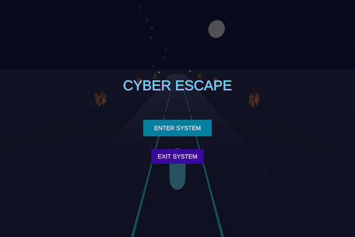
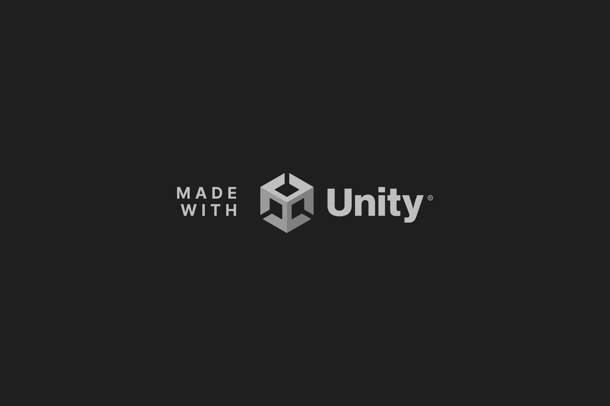
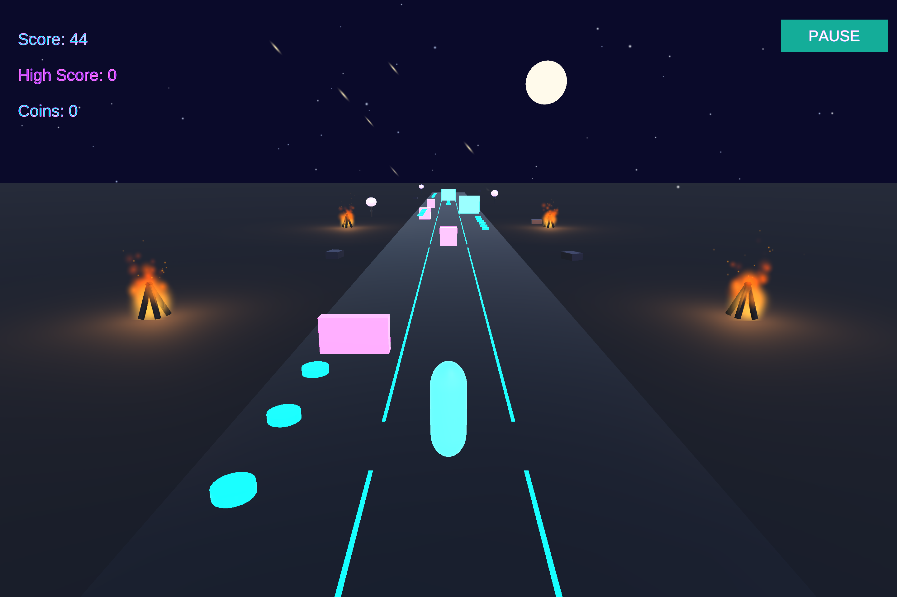

# 赛博夜行者 · CyberEscapeRunner

> Unity 2022.3 LTS / C# / TextMeshPro · 3D 无尽跑酷 · 对象池 · 程序化生成 · FSM + 事件解耦 · AI 辅助开发（MCP）



**完整玩法闭环**：三车道无尽跑酷——切道、跳跃、滑铲躲避障碍，收集金币；速度由 8 m/s 随时间渐进提升至 24 m/s；计分 = 距离 + 金币加权，`PlayerPrefs` 持久化最高分；主菜单 / 暂停 / 结算 / 重开完整 UI 与音频。

| 标题画面（夜景） | 游玩中：跳跃躲避 + 吃金币 |
|:---:|:---:|
|  |  |

## 技术要点

- **通用对象池系统**：`Dictionary<string, Queue<GameObject>>` 多池管理 + 池配置表 + 容器分组，路面、障碍、金币、树木、岩石全部复用，消除运行时频繁 `Instantiate/Destroy` 带来的 GC 开销。
- **程序化生成**：路面与障碍在玩家前方 **150 米**动态铺设、身后 **45 米**自动回收；三车道随机生成障碍与金币序列。
- **架构解耦**：单例 `GameManager` + 游戏状态机（主菜单 / 游玩 / 暂停 / 结算）+ C# 事件（`OnGameStarted`、`OnScoreChanged`、`OnGameOver` 等），UI、音频、玩法互不依赖，可独立修改。
- **难度曲线与计分**：`startingSpeed 8 m/s → maxSpeed 24 m/s` 渐进；距离分 + 金币加权分；`PlayerPrefs` 本地最高分。
- **AI 辅助开发工作流（MCP）**：Trae AI IDE 经 MCP 协议直连 Unity 编辑器，以自然语言驱动编辑器脚本（`StarSkyBuilder` / `MainSceneNightUpgrade` / `StarSkyCapture`）批量生成夜景资产——自定义 `StarSkyDome.shader` 星空穹顶、流星雨粒子、篝火光效（`CampfireFlicker`）与月亮，全程未改动任何玩法代码。

## 操作说明

| 按键 | 功能 |
|---|---|
| A / D 或 ← / → | 三车道左右切换 |
| 空格 | 跳跃（开始界面也可启动游戏） |
| Ctrl | 滑铲 |
| Esc | 暂停 / 恢复 |

## 运行

**方式一：Unity 编辑器**

用 Unity Hub 安装 **2022.3.62f3c1**，打开本工程，进入 `Assets/Scenes/MainScene.unity` 点击 Play。首次打开如提示导入 TextMeshPro essentials，确认导入即可。

**方式二：命令行构建独立可执行文件**

```powershell
Unity.exe -batchmode -quit -projectPath <工程路径> `
  -executeMethod BuildScript.BuildWin64 -logFile build.log
# 产物：Builds/CyberEscapeRunner/CyberEscapeRunner.exe
```

## 项目结构

```
CyberEscapeRunner/
├── Assets/
│   ├── Art/                 # 材质 + StarSky/（自定义星空穹顶 Shader 等）
│   ├── Editor/              # 编辑器脚本（场景构建、夜景升级、截图验证、CLI 构建）
│   ├── Prefabs/             # 路面 / 障碍 / 金币 / 树木 / 岩石预制体
│   ├── Scenes/              # MainScene（夜景完整玩法）、StarSky（艺术展示）
│   ├── Scripts/
│   │   ├── Core/GameManager.cs        # 单例 + 状态机 + C# 事件 + 计分
│   │   ├── Player/PlayerController.cs # 三车道移动 / 跳跃 / 滑铲
│   │   ├── Systems/                   # ObjectPool / SpawnManager / CoinSystem ...
│   │   ├── UI/UIManager.cs            # 菜单 / 暂停 / 结算面板
│   │   └── CampfireFlicker.cs         # 篝火光效
│   └── TextMesh Pro/
├── ProjectSettings/         # 含 McpUnitySettings.json（MCP 配置）
└── tools/capture-demo.ps1   # 自动化演示素材采集（窗口注入按键 + PrintWindow 抓帧）
```

## 说明

- 基于开源模板 unity-3d-endless-runner-game 搭建并二次开发（对象池、生成规则、状态机与事件解耦、难度与计分参数、AI 辅助夜景场景、CLI 构建与演示采集工具链均在模板基础上实现 / 调整）。
- `media/` 内演示素材由 `tools/capture-demo.ps1` 自动采集：启动构建产物、注入菜单点击与键盘输入、`PrintWindow` 逐帧抓取，ffmpeg 合成 GIF / MP4。
- 学习 / 作品集用途，美术资源版权归原作者所有。
